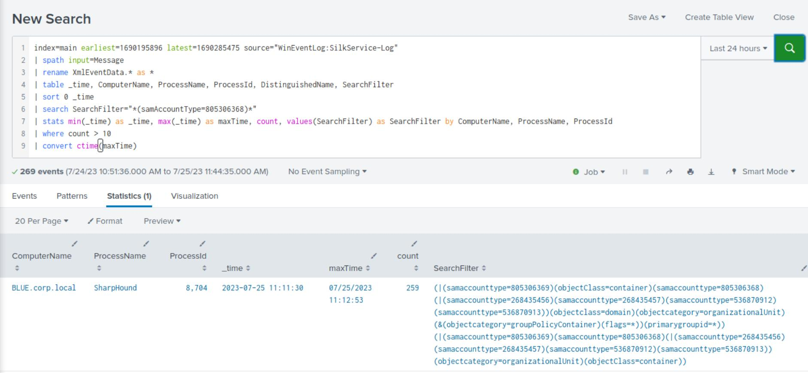
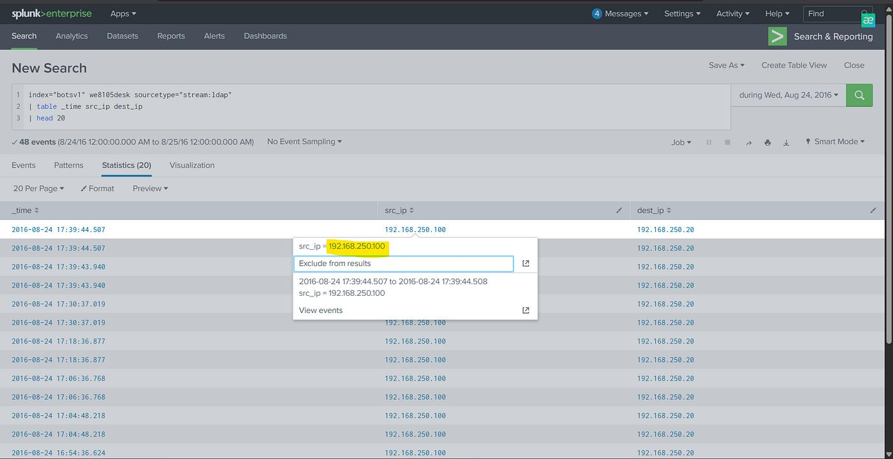

# 01 - LDAP Reconnaissance - Detecting LDAP Reconnaissance with Splunk
Write-up of Hack The Box Academy labs. Practice Work

## Executive Summary

This investigation analyzed Active Directory reconnaissance activity using Splunk and LDAP client telemetry collected through SilkService, with a focus on identifying processes performing domain user enumeration.

This investigation examined LDAP query activity captured through SilkService logs and identified processes that performed LDAP searches containing the filter:

*(samAccountType=805306368)*

This filter is commonly associated with domain user enumeration.

The investigation identified multiple processes issuing LDAP queries containing the user enumeration filter *(samAccountType=805306368)*. Among the observed processes, **rundll32.exe** was identified as an unusual source of LDAP reconnaissance activity.

The analysis demonstrated how LDAP search filters and process-level telemetry can be correlated to identify potentially suspicious reconnaissance behavior and generate actionable threat-hunting leads.

## Investigation Objectives

The objectives of this investigation were:

•	Identify LDAP-based reconnaissance activity.

•	Detect processes issuing suspicious LDAP queries.

•	Use Splunk to analyze SilkService LDAP telemetry.

•	Identify all process names associated with user enumeration LDAP filters.

•	Map the observed activity to MITRE ATT&CK.

•	Document detection opportunities for SOC use.

- Assess whether LDAP queries originating from unexpected Windows processes represent potential reconnaissance activity.
  
## LDAP Reconnaissance and Detection Context

LDAP provides direct access to Active Directory objects, allowing users, groups, computers, service accounts and other directory objects to be enumerated through structured search queries.

LDAP query monitoring provides visibility into directory enumeration activity that may not be apparent from process names alone. Correlating search filters with the originating process can help identify unusual reconnaissance behavior.

## LDAP Search Filters

LDAP queries rely on search filters that define which directory objects should be returned. One of the most common filters used during user enumeration is:

`(samAccountType=805306368)`

This value corresponds to standard domain user accounts. Consequently, LDAP queries containing the filter `*(samAccountType=805306368)*` may indicate Active Directory user enumeration activity.

The filter was selected as the primary detection indicator because it enables investigation of domain user enumeration across multiple processes, including legitimate Windows utilities and offensive security tools.

## Detection Challenge

By default, Windows does not reliably log all LDAP queries.

Although Event ID 1644 can provide LDAP visibility, additional LDAP client telemetry can be collected using the Microsoft-Windows-LDAP-Client ETW Provider. In this investigation, LDAP events were collected using SilkService and analyzed in Splunk.

## Data Source

| Source | Value |
|---------|-------|
| Splunk Index | main |
| Event Source | WinEventLog:SilkService-Log |
| Telemetry | Microsoft-Windows-LDAP-Client ETW |

### Relevant Fields

| Field |
|-------|
| ComputerName |
| ProcessName |
| ProcessId |
| DistinguishedName |
| SearchFilter |

## Investigation Scope

The investigation focused on identifying processes issuing LDAP queries containing the user enumeration filter *(samAccountType=805306368)* and determining whether unexpected processes were performing Active Directory reconnaissance.

## Investigation Methodology

The investigation involved executing a Splunk search across the complete dataset, filtering LDAP queries containing the target SearchFilter value, and grouping the results by ProcessName to identify all processes performing user enumeration.

The investigation followed three analytical steps:

1. Extract LDAP client events and their associated process metadata from SilkService logs.

2. Filter LDAP searches targeting domain user accounts using the **samAccountType=805306368** indicator.

3. Aggregate the matching events by process name and review unusual processes as potential reconnaissance indicators.

## Splunk Search Used

```spl
index=main source="WinEventLog:SilkService-Log"
| spath input=Message
| rename XmlEventData.* as *
| table _time, ComputerName, ProcessName, ProcessId, DistinguishedName, SearchFilter
| sort 0 _time
| search SearchFilter="*(samAccountType=805306368)*"
| stats count by ProcessName
``` 
### Figure 1 - LDAP User Enumeration 



### Query Breakdown

The Splunk query was structured to extract LDAP telemetry, identify searches targeting domain user accounts, and aggregate matching events by process name.

#### Index and Source

index=main source="WinEventLog:SilkService-Log"

This searches LDAP telemetry collected by SilkService.

#### Extract Structured Fields 

| spath input=Message

This extracts structured data from the Message field.

#### Rename XML Fields 

| rename XmlEventData.* as *

This removes the XmlEventData. prefix from fields to make them easier to use.

#### Select Relevant Fields 

| table _time, ComputerName, ProcessName, ProcessId, DistinguishedName, SearchFilter

This displays the fields needed for investigation.

#### Sort Events 

| sort 0 _time

This sorts all matching events by time.

#### Search for User Enumeration LDAP Filter 

| search SearchFilter="*(samAccountType=805306368)*"

This filters LDAP searches containing the user enumeration filter.

#### Group by Process Name 

| stats count by ProcessName

This summarizes which processes issued the LDAP queries.

The final aggregation provides a process-level overview of matching LDAP activity, allowing analysts to identify unusual executables for further investigation.

## Investigation Findings 

The investigation identified the following processes performing LDAP user enumeration:

- N/A
- Rubeus
- SharpHound
- mmc
- powershell
- rundll32

Among these, **rundll32.exe** represented the most unusual process and warranted further investigation.

The presence of Rubeus and SharpHound was also relevant because these tools can be associated with offensive Active Directory operations. However, process identification and LDAP filter matches alone are insufficient to establish malicious intent without additional context.

The **N/A** result also indicates that some matching events did not contain an identifiable process name, limiting process attribution for those records.

### Figure 2 - LDAP SearchFilter Evidence 



## Suspicious Process Analysis - rundll32.exe 

rundll32.exe is a legitimate Windows binary used to execute functions exported from DLL files.

Seeing rundll32 associated with LDAP reconnaissance is suspicious because it suggests LDAP enumeration may have been performed through a proxy execution technique rather than a normal administrative tool.

As a legitimate Windows binary that can be abused for proxy execution, rundll32.exe represents a relevant candidate for deeper investigation when associated with directory enumeration activity.

## Forensic Interpretation

The observed activity indicates that rundll32.exe issued LDAP queries containing the domain user enumeration filter *(samAccountType=805306368)*. Although this behaviour alone does not confirm malicious activity, it represents a high-value threat hunting lead because rundll32.exe is frequently abused as a Living-off-the-Land Binary (LOLBIN).

Further investigation would require correlation with process creation events, command-line arguments, parent processes, DLL execution details, and associated network activity to determine whether the observed LDAP queries were legitimate or attacker-driven.

The available evidence supports suspicious LDAP enumeration activity but does not independently confirm successful compromise, malicious DLL execution, or attacker-controlled process behavior.

## Detection Opportunities

### Detect LDAP User Enumeration

Search for:

samAccountType=805306368

in LDAP SearchFilter fields.

### Detect Suspicious Processes Performing LDAP Queries

Prioritize unusual process names such as:

- rundll32

- regsvr32

- powershell

- cmd

- wscript

- cscript

- mshta

These process names should be treated as investigation candidates rather than standalone indicators of compromise. Their relevance depends on the associated LDAP filters, execution context, and expected administrative activity.

### Detect High-Volume LDAP Queries

A single query may be normal.

Repeated LDAP queries from the same process should be investigated.

Example logic:

| stats count by ComputerName, ProcessName, ProcessId
| where count > 10

The threshold of 10 events is illustrative and should be calibrated against normal LDAP activity in the monitored environment to reduce false positives.

This detection logic is a proposed hunting opportunity and was not validated as a production detection rule in the investigation.

### Detect SharpHound Behavior

Look for multiple LDAP filters associated with:

•	Users

•	Groups

•	Computers

•	ACLs

•	Trusts

•	Sessions

•	SPNs

Correlating multiple enumeration-related LDAP filters from the same process may help identify broader Active Directory reconnaissance activity.

## MITRE ATT&CK Mapping

| Tactic | Technique | ATT&CK ID | Investigation Relevance |
|--------|-----------|-----------|-------------------------|
| Discovery | Account Discovery | T1087 | Enumerating user accounts through LDAP queries |
| Discovery | Domain Account Discovery | T1087.002 | Identifying domain user accounts |

The observed LDAP user enumeration most directly supports MITRE ATT&CK technique T1087.002 (Domain Account Discovery). The mapping is limited to account discovery because the documented LDAP search filter directly supports user enumeration. Other Active Directory discovery techniques would require additional supporting telemetry.

## Key Findings

| Finding | Summary |
|---------|---------|
| LDAP Telemetry | SilkService provided visibility into LDAP client activity. |
| Search Filter Analysis | LDAP `SearchFilter` values were used to identify domain user enumeration. |
| Splunk Investigation | Splunk grouped LDAP activity by `ProcessName` to identify participating processes. |
| Reconnaissance Activity | Multiple processes, including administrative utilities and security-relevant tools, were associated with LDAP user enumeration queries. |
| Suspicious Process | `rundll32.exe` represented the most unusual process observed during the investigation. |
| Detection Value | LDAP search filters provide valuable behavioral indicators for detecting Active Directory reconnaissance. |

**Investigation Limitation**: The available results identify matching LDAP search activity and originating process names but do not provide sufficient execution context to conclusively attribute the activity to an attacker.

## Conclusion

This investigation demonstrated how LDAP telemetry can be used to detect Active Directory reconnaissance activity.

By focusing on LDAP search filters rather than only process creation events, analysts can identify domain enumeration activity generated by tools such as SharpHound, Rubeus, PowerShell, MMC, and suspicious LOLBINs such as rundll32.

The findings highlight the importance of correlating LDAP telemetry with endpoint process information to distinguish legitimate directory queries from potentially malicious reconnaissance. In this lab investigation, rundll32.exe was identified as a priority for further analysis, rather than a confirmed indicator of compromise.

This exercise strengthened practical skills in Splunk SPL querying, LDAP telemetry analysis, suspicious process identification, and MITRE ATT&CK mapping, while highlighting the importance of evidence-based conclusions in SOC investigations.
