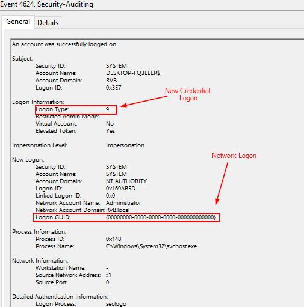

# 02 - Detecting Pass-the-Hash 
Write-up of Hack The Box Academy labs. Practice work.

## Executive Summary 

This investigation examined Windows authentication artifacts associated with potential Pass-the-Hash (PtH) activity using Splunk. The analysis focused on NewCredentials logon sessions, Windows Security Event ID 4624, and Sysmon telemetry related to LSASS process access.

The initial investigation identified **BLUE.corp.local** as a host generating Logon Type 9 events through the **seclogo** logon process. A second Splunk query was developed to correlate LSASS access with subsequent NewCredentials authentication events, providing a behavioral detection approach for identifying potential credential abuse.

## Investigation Objectives 

- Detect Pass-the-Hash authentication artifacts.
  
- Identify NewCredentials logon sessions.
  
- Analyze the relationship between Logon Type 9 and the Secondary Logon service.
  
- Correlate LSASS access with authentication activity.
  
- Reduce false positives through event correlation.
  
- Map observed behavior to MITRE ATT&CK. 

## Background 

### What is Pass-the-Hash? 

Pass-the-Hash (PtH) is a credential abuse technique in which an attacker authenticates using an NTLM hash instead of the user's plaintext password. By leveraging stolen authentication material, attackers can access remote systems without ever knowing the original credentials.

## Authentication Artifacts Relevant to Detection

Pass-the-Hash activity may involve credential material manipulation, NewCredentials logon sessions, and subsequent remote authentication. These behaviors can be investigated through Windows Security logs and Sysmon process telemetry.

Legitimate administrative activity, particularly **runas /netonly**, may produce similar authentication artifacts. Consequently, Logon Type 9 should be treated as an investigation lead rather than conclusive evidence of Pass-the-Hash.

## Key Detection Artifact 

One of the relevant authentication patterns associated with Pass-the-Hash is:

-	Security Event ID 4624
  
-	Logon Type = 9
  
-	Logon Process = seclogo
  
This combination indicates a **NewCredentials** authentication session and is frequently observed during Pass-the-Hash attacks, credential injection, and legitimate `runas /netonly` executions.

## MITRE ATT&CK Mapping (Background) 

| Technique | ATT&CK ID |
|-----------|-----------|
| Pass-the-Hash | T1550.002 |
| OS Credential Dumping: LSASS Memory | T1003.001 |
| Lateral Movement | TA0008 |
| Defense Evasion | TA0005 |

## Data Sources

| Source | Purpose |
|---------|----------|
| Windows Security Logs | Authentication telemetry |
| Sysmon | Process telemetry |
| Splunk Index (main) | Centralized log analysis |
| Security Event ID 4624 | Successful logon events |
| Sysmon Event ID 10 | LSASS process access |

## Investigation Scope 

The investigation focused on identifying hosts exhibiting NewCredentials authentication sessions during the specified time window and correlating those events with Sysmon telemetry to determine whether the observed behavior was consistent with Pass-the-Hash activity.

## Investigation Methodology 

The investigation followed a structured four-stage correlation process:

1. Identify successful NewCredentials logon sessions.
   
2. Filter authentication events using Logon Type 9.
   
3. Validate the Secondary Logon process (seclogo).
   
4. Attribute the activity to the originating host.

A subsequent correlation query examined Sysmon Event ID 10 activity targeting LSASS alongside NewCredentials logons to develop a more context-aware detection approach.

## NewCredentials Authentication Analysis

### Purpose:

Identify NewCredentials logon sessions associated with Security Event ID 4624, Logon Type 9, and the Secondary Logon process.

### SPL:

```spl
index=main earliest=1690543380 latest=1690545180
source="WinEventLog:Security"
EventCode=4624
Logon_Type=9
Logon_Process=seclogo
| table _time, ComputerName, EventCode, user,
Network_Account_Domain,
Network_Account_Name,
Logon_Type,
Logon_Process
```

### Results:

| Field | Value |
|-------|-------|
| Computer Name | `BLUE.corp.local` |

### Figure 5 - NewCredentials Authentication Analysis 



### Query Analysis

The search followed a four-stage filtering process:

1. Identify successful authentication events using Security Event ID 4624.
   
2. Filter for Logon Type 9 to isolate NewCredentials sessions.
   
3. Restrict results to the `seclogo` logon process.
   
4. Identify the host on which the authentication activity occurred.

The results identified **BLUE.corp.local** as a host associated with NewCredentials authentication activity. This finding established a starting point for further investigation but did not independently confirm NTLM hash injection or malicious authentication.

## Detection Logic 

### NewCredentials Authentication

Security Event ID 4624 with `Logon_Type = 9` indicates the creation of a NewCredentials authentication session. This behavior is associated with alternate credential usage and may appear during legitimate administration, `runas /netonly` execution, or Pass-the-Hash activity.

### Secondary Logon Process 

The `seclogo` logon process is associated with the Windows Secondary Logon service and is commonly observed during:

- `runas`
- `runas /netonly`
- Credential injection
- Pass-the-Hash scenarios

### LSASS Access 

Sysmon Event ID 10 should be monitored for access to `lsass.exe`. Classical Pass-the-Hash implementations frequently require access to LSASS memory to extract or manipulate authentication material.

### Event Correlation 

A stronger behavioural detection approach correlates:

- Sysmon Event ID 10 targeting `lsass.exe`
  
- Credential extraction or manipulation
  
- Security Event ID 4624
  
- Logon Type 9
  
- `seclogo`
  
- Subsequent remote authentication activity

Combining these artifacts can improve detection confidence compared with analyzing Logon Type 9 events alone. However, LSASS access and NewCredentials authentication may also occur during legitimate operations, requiring additional contextual validation.

## LSASS Access and NewCredentials Correlation

### Purpose:

Correlate LSASS access with NewCredentials authentication events to identify behavior more closely aligned with Pass-the-Hash activity.

### SPL: 

```spl
index=main earliest=1690450689 latest=1690451116
(source="XmlWinEventLog:Microsoft-Windows-Sysmon/Operational"
EventCode=10
TargetImage="C:\Windows\system32\lsass.exe"
SourceImage!="C:\ProgramData\Microsoft\Windows Defender\platform\*\MsMpEng.exe")
OR
(source="WinEventLog:Security"
EventCode=4624
Logon_Type=9
Logon_Process=seclogo)
| sort _time, RecordNumber
| transaction host maxspan=1m
endswith=(EventCode=4624)
startswith=(EventCode=10)
| stats count by
_time,
Computer,
SourceImage,
SourceProcessId,
Network_Account_Domain,
Network_Account_Name,
Logon_Type,
Logon_Process
| fields - count
```

### Query Analysis

The second query extends the initial investigation by correlating Security Event ID 4624 with Sysmon Event ID 10. This approach combines authentication activity with LSASS memory access, producing a behavioral pattern that more closely resembles Pass-the-Hash activity while potentially improving detection specificity.

### Why the Correlation Query is Stronger

The first query detects Security Event ID 4624 events with Logon Type 9 and the `seclogo` logon process. Although this is a useful indicator, legitimate `runas /netonly` activity may generate the same authentication pattern.

The second query adds Sysmon Event ID 10 telemetry showing access to `lsass.exe`. Correlating LSASS access with a subsequent NewCredentials logon provides additional context and may reveal a behavioral pattern more consistent with Pass-the-Hash activity.

**Investigation limitation**: The documented query uses a one-minute transaction window to associate LSASS access with subsequent authentication events on the same host. This provides temporal correlation but does not independently prove that the LSASS access caused the NewCredentials logon. The source document also does not include a concrete result table for this second query, so its effectiveness cannot be confirmed from the supplied evidence alone.

## Investigation Artifacts and Detection References

| IOC Type | Value |
|-----------|-------|
| Authentication Indicators | Logon Type 9, Logon Process = seclogo |
| Host | BLUE.corp.local |

**Relevant Event IDs**: Security Event ID 4624 and Sysmon Event ID 10 were used in the documented investigation queries. Additional events, such as 4648 and 4672, may provide authentication and privilege context during further analysis.

The host and authentication indicators are investigation artifacts rather than standalone Indicators of Compromise. The supplied results do not independently demonstrate Mimikatz execution or the use of **sekurlsa::pth**.

## MITRE ATT&CK Mapping

| Tactic | Technique | ATT&CK ID | Investigation Relevance |
|--------|-----------|-----------|-------------------------|
| Credential Access | OS Credential Dumping: LSASS Memory | T1003.001 | Credential extraction from LSASS |
| Defense Evasion / Lateral Movement | Pass-the-Hash | T1550.002 | NTLM hash authentication abuse |

**Mapping note**: T1550.002 (Pass the Hash) is the primary technique investigated in this section. T1003.001 (OS Credential Dumping: LSASS Memory) is relevant to the LSASS-access detection logic but should not be treated as a confirmed credential-dumping finding without additional evidence of credential extraction.

The documented results establish NewCredentials authentication activity on **BLUE.corp.local**, while the correlation query represents a detection approach for investigating possible Pass-the-Hash behavior. The supplied evidence does not independently confirm successful Pass-the-Hash authentication or lateral movement.

## Lessons Learned

| Lesson | Description |
|---------|-------------|
| NTLM Authentication | Pass-the-Hash abuses NTLM hashes instead of plaintext passwords. |
| Authentication Artifacts | Logon Type 9 is a valuable indicator but should not be treated as conclusive evidence. |
| Administrative Activity | `runas /netonly` produces artifacts similar to Pass-the-Hash and requires contextual analysis. |
| LSASS Monitoring | Monitoring LSASS access significantly improves detection capability. |
| Event Correlation | Correlating Security and Sysmon events can improve detection specificity when supported by appropriate contextual validation. |
| Behavioral Detection | Behavioral correlation is more reliable than monitoring isolated events. |

## Conclusion

This investigation demonstrated a Splunk-based approach for identifying authentication artifacts associated with potential Pass-the-Hash activity. Analysis of Windows Security Event ID 4624 identified NewCredentials logon sessions on **BLUE.corp.local**, while a second SPL query was developed to correlate LSASS process access with subsequent authentication events.

The investigation highlights the importance of combining Windows authentication logs with Sysmon process telemetry to improve visibility into potential credential abuse. Although the documented results do not independently confirm successful Pass-the-Hash execution, the correlation methodology provides a foundation for further threat hunting and detection engineering.
