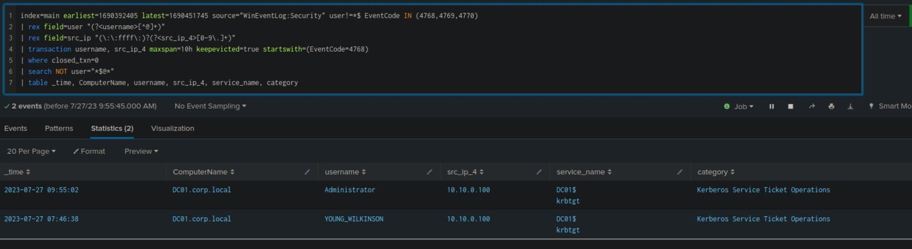

# 02 - Detecting Pass-the-Ticket 
Write-up of Hack The Box Academy labs. Practice work.

## Executive Summary

This investigation analyzed Kerberos authentication events using Splunk to identify incomplete authentication sequences potentially associated with Pass-the-Ticket (PtT) activity. The analysis focused on correlating Windows Security Event IDs 4768, 4769, and 4770 through transaction-based SPL searches.

The investigation identified **Administrator** and **YOUNG_WILKINSON** in the transaction analysis results, with **YOUNG_WILKINSON** highlighted in the recorded findings. These results provided leads for further investigation into possible Kerberos ticket reuse, although the available telemetry did not independently confirm stolen ticket injection.

## Investigation Objectives

- Detect Pass-the-Ticket authentication artifacts.
- Identify incomplete Kerberos authentication sequences.
- Correlate Kerberos ticket activity across multiple event types.
- Detect missing Ticket Granting Ticket (TGT) requests.
- Reduce false positives through transaction-based correlation.
- Map observed behavior to MITRE ATT&CK.

## Background 

### What is Pass-the-Ticket?

Pass-the-Ticket (PtT) is a credential abuse technique in which an attacker steals and reuses Kerberos tickets instead of authenticating with a plaintext password or NTLM hash.

Rather than possessing valid credentials, the attacker authenticates using a previously obtained:

- Ticket Granting Ticket (TGT)
- Service Ticket TGS)

The technique allows an attacker to reuse existing Kerberos authentication material without knowing the account's plaintext password.

## Kerberos Authentication Flow

| Step | Activity | Related Event |
|------|----------|---------------|
| 1 | Client requests a Ticket Granting Ticket (TGT) | Event ID 4768 |
| 2 | Domain Controller issues the TGT | — |
| 3 | Client requests a Service Ticket (TGS) | Event ID 4769 |
| 4 | Domain Controller issues the TGS | — |
| 5 | Client authenticates to the target service | Event ID 4624 |

This table represents a simplified Kerberos authentication workflow. Existing cached tickets may be reused without generating a new Event ID 4768 for every service ticket request.

## Pass-the-Ticket Detection Context 

Pass-the-Ticket may involve importing an existing Kerberos ticket rather than requesting new authentication material. Consequently, some ticket reuse scenarios may generate service ticket activity without a corresponding TGT request within the observed time window.

However, legitimate Kerberos ticket caching and long-lived authentication sessions can produce similar patterns. Missing Event ID 4768 records should therefore be treated as investigation leads rather than conclusive evidence of ticket theft.

## Primary Detection Indicator 

The primary detection hypothesis examined in this investigation was the presence of Kerberos service ticket activity without an associated TGT request within the available observation window. This pattern can support Pass-the-Ticket threat hunting when correlated with user identity, source IP address, service information, and additional endpoint evidence.

## MITRE ATT&CK Mapping (Background) 

| Technique | ATT&CK ID |
|-----------|-----------|
| Pass-the-Ticket | T1550.003 |
| Steal or Forge Kerberos Tickets | T1558 |
| Lateral Movement | TA0008 |
| Defense Evasion | TA0005 |

## Data Sources 

| Source | Purpose |
|---------|----------|
| Windows Security Logs | Kerberos authentication events |
| Splunk Index (main) | Centralized log analysis |
| Event ID 4768 | Ticket Granting Ticket requests |
| Event ID 4769 | Service Ticket requests |
| Event ID 4770 | Ticket renewals |
| Event ID 4624 | Successful logons |

The documented SPL investigation directly queried Event IDs 4768, 4769, and 4770. Event ID 4624 is relevant for additional authentication correlation but was not included in the supplied investigation query.

## Investigation Scope

The investigation focused on identifying user accounts exhibiting incomplete Kerberos authentication sequences by correlating Ticket Granting Ticket requests, Service Ticket requests, and ticket renewal events using Splunk transaction analysis.

## Investigation Methodology 

The investigation followed a structured seven-stage correlation process:

1. Collect Kerberos authentication events.
   
2. Exclude machine accounts.
   
3. Normalize usernames.
   
4. Normalize source IPv4 addresses.
   
5. Build Kerberos authentication transactions.
    
6. Identify incomplete authentication sequences.
    
7. Attribute suspicious activity to individual user accounts.

## Kerberos Transaction Analysis

### Purpose: 

Identify user accounts potentially performing Pass-the-Ticket activity by reconstructing Kerberos authentication transactions and detecting Service Ticket requests that occur without an associated Ticket Granting Ticket request.

### SPL:

```spl
index=main earliest=1690392405 latest=1690451745
source="WinEventLog:Security"
user!=*$
EventCode IN (4768,4769,4770)
| rex field=user "(?[^@]+)"
| rex field=src_ip "(::ffff:)?(?<src_ip_4>[0-9.]+)"
| transaction username, src_ip_4
maxspan=10h
keepevicted=true
startswith=(EventCode=4768)
| where closed_txn=0
| search NOT user="$@"
| table _time,
ComputerName,
username,
src_ip_4,
service_name,
category
```

### Results

| Field | Value |
|-------|-------|
| Identified Users | Administrator, YOUNG_WILKINSON |
| Missing Username | YOUNG_WILKINSON |

The recorded results identified **Administrator** and **YOUNG_WILKINSON** as accounts associated with the transaction analysis. The supplied results additionally highlighted **YOUNG_WILKINSON**, although the meaning of the original label "Missing Username" cannot be established from the summary alone.

### Figure 6 - Kerberos Transaction Analysis 




### Query Analysis 

The SPL search collects Kerberos Event IDs 4768, 4769, and 4770 while filtering out machine accounts. It extracts normalized usernames and IPv4 addresses, then groups related authentication events using Splunk's **transaction** command over a maximum ten-hour window.

The search retains transactions marked as open and returns associated account information. These results provide candidates for further investigation, but additional event-level validation is necessary to establish whether a service ticket request genuinely occurred without an associated TGT request.

## Detection Logic

### Missing Ticket Granting Ticket

Event ID 4769 without an associated Event ID 4768 within the available observation window may indicate ticket reuse, but it can also result from legitimate Kerberos caching or incomplete log coverage.

### Ticket Renewal Analysis

Event ID 4770 can provide additional context about Kerberos ticket renewal activity. Its presence without a nearby Event ID 4768 is not independently sufficient to identify an imported ticket.

### Unexpected Kerberos Activity 

Investigate unusual combinations of:

- Computer Name
- Source IP Address
- Service Name

Unexpected relationships between these fields may indicate suspicious Kerberos authentication activity.

### Authentication Flow Correlation

Correlating TGT requests, service ticket requests, and successful authentication events can help analysts investigate unusual Kerberos behavior. The absence of a particular event must be evaluated against ticket lifetime, log availability, and expected authentication patterns.

## Transaction-Based Detection

Transaction-based analysis provides a method for grouping Kerberos authentication events by account and source IP address. This approach supports investigation of authentication patterns across multiple event types rather than relying on individual events.

For reliable detection, the transaction logic must distinguish between missing TGT requests, incomplete log coverage, and legitimate ticket reuse. The resulting candidates should be validated against individual Kerberos events and available endpoint telemetry.

## Investigation Artifacts and Detection References

| IOC Type | Value |
|-----------|-------|
| Authentication Indicators | Missing TGT, Open Transactions, Unexpected Service Tickets |
| Users | Administrator, YOUNG_WILKINSON |

**Analyzed Event IDs**: 4768, 4769, and 4770.

**Detection References**: Event IDs 4624 and 4672 may provide additional authentication and privilege context, but they were not included in the documented search.

The identified user accounts and incomplete transaction patterns represent investigation artifacts rather than confirmed Indicators of Compromise. No direct evidence of Mimikatz execution, Rubeus execution, or stolen Kerberos ticket injection was provided in the documented results.

## MITRE ATT&CK Mapping

| Tactic | Technique | ATT&CK ID | Investigation Relevance |
|--------|-----------|-----------|-------------------------|
| Credential Evasion / Lateral Movement | Pass-the-Ticket | T1550.003 | Authentication using stolen Kerberos tickets |

**Mapping note**: T1550.003 (Pass the Ticket) is the primary technique addressed by the investigation's detection hypothesis. The documented transaction results identify authentication patterns for further analysis but do not independently confirm that stolen Kerberos tickets were used.

T1558 (Steal or Forge Kerberos Tickets) would require additional evidence of ticket theft, forgery, or related activity. TA0008 and TA0005 are MITRE ATT&CK tactics rather than techniques and therefore do not need separate rows in this table.

## Detection Engineering Notes

| Consideration | Description |
|--------------|-------------|
| Long-lived Kerberos Sessions | Long-lived sessions may legitimately generate Event ID 4769 without a corresponding Event ID 4768 within the available retention period. |
| Domain Controllers | Domain Controllers generate large volumes of Kerberos authentication events and should be baselined before alerting. |
| Service Accounts | Service accounts often exhibit authentication patterns that differ from interactive user accounts and require contextual validation. |

**Additional limitation**: The search uses a ten-hour transaction window, which may not capture earlier TGT requests associated with legitimately cached tickets. The resulting transaction status should not be interpreted as definitive proof of malicious ticket reuse.

## Lessons Learned

| Lesson | Description |
|---------|-------------|
| Kerberos Authentication | Pass-the-Ticket abuses Kerberos tickets rather than passwords or NTLM hashes. |
| Missing TGT Detection | Event ID 4769 without a preceding Event ID 4768 is a potential hunting indicator that requires additional validation. |
| Transaction Analysis | Correlating multiple Kerberos events is more context-rich than analyzing isolated events. |
| Event Correlation | Correlating usernames, source IP addresses and service names can help improve detection specificity. |
| Authentication Gaps | Missing Kerberos events may indicate ticket reuse but can also reflect normal ticket caching or incomplete telemetry. |

## Conclusion

This investigation demonstrated a Splunk-based approach for examining Kerberos authentication sequences potentially associated with Pass-the-Ticket activity. Transaction analysis of Windows Security Event IDs 4768, 4769, and 4770 identified **Administrator** and **YOUNG_WILKINSON** as accounts requiring further investigation.

The exercise highlighted the value of correlating authentication events by username and source IP address, while also demonstrating the limitations of identifying ticket reuse solely through missing TGT requests. Additional endpoint evidence and event-level validation would be required to confirm Pass-the-Ticket activity.
