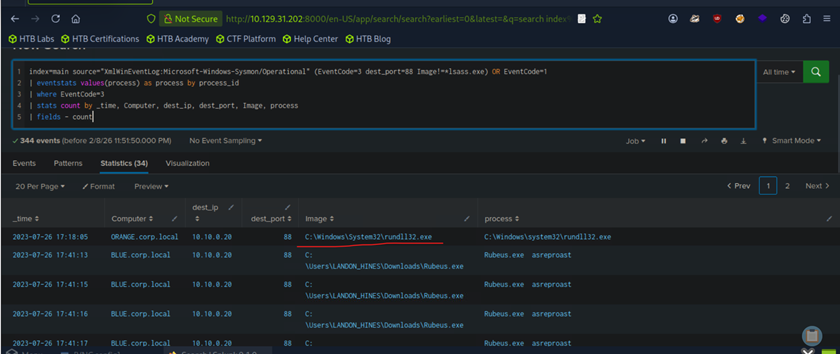

# 03 - Detecting Overpass-the-Hash 

## Executive Summary 

This investigation examined potential Overpass-the-Hash (Pass-the-Key) activity using Splunk by correlating Sysmon Process Creation (Event ID 1) and Network Connection (Event ID 3) telemetry.

The analysis identified **Rubeus.exe** and **rundll32.exe** in Kerberos-related network activity involving destination port 88. The investigation highlighted **rundll32.exe** as a process requiring additional analysis because direct Kerberos communication from this executable can indicate unusual authentication behavior.

These findings demonstrate a process-to-network threat hunting approach relevant to Overpass-the-Hash detection, although the available evidence does not independently confirm the use of stolen authentication material or successful Kerberos ticket acquisition.

## Investigation Objectives 

- Detect Overpass-the-Hash authentication artifacts.
  
- Identify processes initiating Kerberos communication.
  
- Detect non-standard processes connecting to Domain Controllers over port 88.
  
- Correlate process creation with network activity.
  
- Reduce false positives through process-to-network correlation.
  
- Map observed behavior to MITRE ATT&CK.

## Background 

### What is Overpass-the-Hash?

Overpass-the-Hash (OPTH), also known as **Pass-the-Key**, is a credential abuse technique in which an attacker uses an NTLM hash or an AES key to request a Kerberos Ticket Granting Ticket (TGT) from a Domain Controller.

Unlike Pass-the-Hash, the stolen authentication material is not used directly for NTLM authentication. Instead, it is leveraged to obtain Kerberos tickets that can subsequently be used for authentication and lateral movement.

### Difference from Pass-the-Hash

Traditional Pass-the-Hash relies on NTLM authentication using a stolen NTLM hash. In contrast, Overpass-the-Hash uses the same authentication material to request a Kerberos Ticket Granting Ticket (TGT), allowing subsequent authentication through the Kerberos protocol.

For detection purposes, process-to-network correlation can complement authentication log analysis by identifying unexpected executables communicating directly with Kerberos services.

## Authentication Comparison 

| Pass-the-Hash | Overpass-the-Hash |
|---------------|-------------------|
| NTLM Hash | NTLM Hash / AES Key |
| NTLM Authentication | Kerberos AS-REQ |
| Direct NTLM Authentication | Ticket Granting Ticket (TGT) |
| NTLM Session | Kerberos Authentication |
| Lateral Movement | Lateral Movement |

## Why Detection Is More Challenging 

Traditional Pass-the-Hash activity often generates authentication artifacts such as Security Event ID 4624 (Logon Type 9) and may require manipulation of LSASS memory.
Overpass-the-Hash performed with tools such as **Rubeus** may not generate these artifacts. Instead, it produces Kerberos network traffic that closely resembles legitimate authentication, making process-to-network correlation significantly more valuable than monitoring individual authentication events.

However, communication with Kerberos port 88 is not inherently malicious. The executable identity, destination, process lineage, and associated authentication events must be considered before attributing the activity to credential abuse.

## Key Detection Artifact

A relevant behavioral detection indicator is an unexpected process initiating a network connection to a Domain Controller over Kerberos port 88. Such activity can support investigation of Overpass-the-Hash when correlated with process execution context and Kerberos authentication telemetry.

## MITRE ATT&CK Mapping (Background) 

| Technique | ATT&CK ID |
|-----------|-----------|
| Overpass-the-Hash (Pass-the-Key) | T1550 |
| Pass-the-Hash | T1550.002 |
| Pass-the-Ticket | T1550.003 |
| Steal or Forge Kerberos Tickets | T1558 |

## Data Sources 

| Source | Purpose |
|---------|----------|
| Sysmon | Process and network telemetry |
| Splunk Index (main) | Centralized log analysis |
| Sysmon Event ID 1 | Process Creation |
| Sysmon Event ID 3 | Network Connections |
| Kerberos (Port 88) | Authentication traffic |

## Investigation Scope 

The investigation focused on identifying non-standard processes communicating with Domain Controllers over Kerberos (TCP/UDP port 88) and correlating those network connections with Sysmon Process Creation events to attribute the activity to the responsible executable.

## Investigation Methodology 

The investigation followed a structured six-stage correlation process:

1. Collect Sysmon network connection events.
   
2. Filter Kerberos communication using destination port 88.
   
3. Exclude expected Windows authentication processes.
   
4. Correlate network activity with Process Creation events.
   
5. Associate Process IDs with executable images.
   
6. Identify suspicious processes communicating with Domain Controllers.

## Sysmon Process-to-Network Correlation

### Purpose:

Identify non-standard processes communicating with Domain Controllers over Kerberos (TCP/UDP port 88) by correlating Sysmon Network Connection and Process Creation events.

### SPL:

```spl
index=main
source="XmlWinEventLog:Microsoft-Windows-Sysmon/Operational"
(EventCode=3 dest_port=88 Image!=*lsass.exe)
OR EventCode=1
| eventstats values(process) as process by process_id
| where EventCode=3
| stats count by
_time,
Computer,
dest_ip,
dest_port,
Image,
process
| fields – count
```

### Results

| Field | Value |
|-------|-------|
| Identified Images | Rubeus.exe, rundll32.exe |
| Missing Image | rundll32.exe |

The recorded results identify Rubeus.exe and rundll32.exe as process images associated with the investigation. The original result labels rundll32.exe as the "Missing Image"; this label should be clarified if the original Splunk output is available.

### Figure 7 - Sysmon Process-to-Network Correlation 



### Query Analysis

The search identifies Sysmon Event ID 3 connections targeting destination port 88 while excluding connections initiated by **lsass.exe**. Sysmon Event ID 1 records are included to provide process creation context, with correlation attempted through the process identifier.

The resulting process information can help identify unusual Kerberos clients. However, process attribution should be validated using consistent host and process identifiers before drawing conclusions about the executable responsible for each network connection.

## Investigation Findings 

The investigation identified two process images associated with network connections targeting Kerberos port 88.

Correlation between Sysmon Process Creation and Network Connection events revealed:

| Artifact | Value |
|-----------|-------|
| Protocol | Kerberos |
| Destination Port | 88 |
| Images | Rubeus.exe, rundll32.exe |
| Suspicious Image | rundll32.exe |

The findings highlight **rundll32.exe** for additional investigation due to its unexpected association with Kerberos-related network activity. The documented results do not independently establish that stolen NTLM hashes or AES keys were used to request Kerberos tickets.

## Why Port 88 Matters

Kerberos authentication uses TCP and UDP port 88 for Ticket Granting Ticket (TGT) requests, Ticket Granting Service (TGS) requests, and related Kerberos exchanges. Because legitimate Kerberos traffic is normally generated by Windows authentication components, non-standard processes communicating directly with Domain Controllers over port 88 should be investigated as potential Overpass-the-Hash activity.

A connection to port 88 is a useful hunting indicator, but Sysmon network telemetry alone does not confirm the Kerberos message type or prove malicious authentication.

## Detection Logic

### Process-to-Kerberos Communication

Investigate non-standard processes initiating Kerberos communication with Domain Controllers over TCP or UDP port 88. Legitimate Kerberos authentication is typically performed by Windows authentication components, making unexpected client processes a valuable detection opportunity.

### Rubeus Activity 

Investigate Kerberos communication initiated by **Rubeus.exe**, particularly AS-REQ messages requesting Ticket Granting Tickets (TGTs). Rubeus is one of the most common tools used to perform Overpass-the-Hash attacks.

The documented Sysmon search identifies network connections rather than inspecting Kerberos AS-REQ message contents. Confirmation of AS-REQ activity would require additional Kerberos authentication telemetry or protocol analysis.

### rundll32.exe Abuse

Investigate Kerberos traffic initiated by **rundll32.exe**. This executable does not normally perform Kerberos authentication and therefore represents a high-value behavioral indicator requiring additional investigation.

### Process-to-Network Correlation

Correlating Sysmon Process Creation (Event ID 1) with Network Connection events (Event ID 3) can help associate Kerberos-related network activity with the responsible executable. Accurate correlation depends on consistent process identifiers, host information, and event timing.

## Investigation Artifacts and Detection References

| IOC Type | Value |
|-----------|-------|
| Network Indicators | Port 88, Kerberos traffic, AS-REQ, TGS requests |
| Processes | Rubeus.exe, rundll32.exe |
| Protocol | Kerberos |

**Analyzed Event IDs**: Sysmon Event IDs 1 and 3.

**Additional Detection References**: Windows Security Event IDs 4768 and 4769 can provide supporting Kerberos authentication evidence but were not included in the documented query.

The process images and destination port represent investigation artifacts rather than standalone Indicators of Compromise. The supplied results do not confirm that Kerberos tickets, NTLM hashes, or AES keys were extracted or used.

## Detection Opportunities 

The investigation highlights several behavioral detection opportunities:

- Monitor Sysmon Event ID 3 connections targeting Kerberos (port 88).
  
- Exclude expected Windows authentication processes such as `lsass.exe`.
  
- Correlate network activity with Process Creation telemetry.
  
- Investigate non-standard executables communicating directly with Domain Controllers.
  
- Baseline legitimate Kerberos clients to reduce false positives.

## Detection Engineering Notes

| Consideration | Description |
|--------------|-------------|
| Administrative Tools | Kerberos troubleshooting utilities may legitimately communicate with Domain Controllers over port 88. |
| Security Products | Some EDR and antivirus products generate Kerberos traffic during authentication-related operations. |
| Enterprise Applications | Custom enterprise applications may legitimately use Kerberos authentication and should be validated against an organizational baseline. |

## Comparison of Authentication Techniques 

| Technique | Primary Detection Artifact |
|-----------|----------------------------|
| Pass-the-Hash | Security Event ID 4624 (Logon Type 9, `seclogo`) |
| Pass-the-Ticket | Event ID 4769 without a corresponding Event ID 4768 |
| Overpass-the-Hash | Non-standard process communicating with a Domain Controller over Kerberos (port 88) |


## MITRE ATT&CK Mapping

| Tactic | Technique | ATT&CK ID | Investigation Relevance |
|--------|-----------|-----------|-------------------------|
| Defense Evasion / Lateral Movement | Use Alternate Authentication Material | T1550 | Abuse of alternate authentication material |
| Defense Evasion / Lateral Movement | Pass-the-Hash | T1550.002 | Reuse of stolen NTLM hashes |

**Mapping note**: Overpass-the-Hash using stolen NT hash material is associated with T1550.002 (Pass the Hash), a sub-technique of T1550 (Use Alternate Authentication Material). The mapping describes the attack technique being investigated, not a confirmed attack established by the available results.

T1550.003 and T1558 are not supported as observed techniques by the documented telemetry. The investigation also does not demonstrate successful lateral movement or credential extraction.

## Lessons Learned

| Lesson | Description |
|---------|-------------|
| Kerberos Authentication | Overpass-the-Hash abuses Kerberos authentication rather than NTLM authentication. |
| Process-to-Network Correlation | Correlating process creation with network activity provides additional process attribution context when correlation fields are validated. |
| Kerberos Monitoring | Port 88 is a useful starting point for investigating unusual Kerberos client activity. |
| Sysmon Telemetry | Sysmon Event ID 3 provides valuable visibility into Kerberos communication. |
| LOLBins | `rundll32.exe` is frequently abused to blend malicious activity with legitimate Windows processes. |
| Behavioral Detection | Monitoring processes communicating with Domain Controllers is often more effective than monitoring individual Kerberos events alone. |

## Conclusion

This investigation demonstrated a Splunk-based approach for identifying unexpected processes communicating with Kerberos services over destination port 88. Analysis of Sysmon Event IDs 1 and 3 identified **Rubeus.exe** and **rundll32.exe** as process images associated with Kerberos-related network activity, with **rundll32.exe** highlighted for further investigation.

The exercise illustrates how process-to-network correlation can support investigations of potential Overpass-the-Hash activity. Confirming the attack technique would require additional evidence of Kerberos ticket requests and the use of stolen authentication material.
